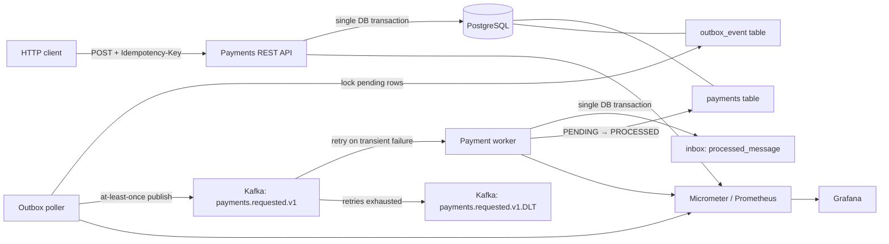

# Payments Service | Java 21 · Spring Boot · Kafka · PostgreSQL

[](./.github/workflows/ci.yml)


A **production-patterns portfolio project**: a small, asynchronous, **simulated** payments service built to demonstrate reliable writes, event-driven processing, database consistency, integration testing, observability and delivery.

> **Safety boundary:** This application does NOT connect to a payment service provider, charge a card, hold funds or move money. `PROCESSED` means the demo worker handled the event—not bank settlement. Do not store or send cardholder data.

## What this repository demonstrates

| Concern | Implemented | Why |
|---|---|---|
| API | Java 21, Spring Boot REST, Bean Validation | Small explicit API and clear HTTP semantics |
| Safe retries | `Idempotency-Key` + PostgreSQL unique constraint + request SHA-256 | Prevents repeat writes for the same key, including concurrent requests |
| Schema evolution | Flyway SQL migration | Reviewable, repeatable schema changes |
| Reliable events | Transactional outbox with `FOR UPDATE SKIP LOCKED` | A payment row and its event are committed together; multi-replica publisher safe |
| Asynchronous processing | Kafka with broker acknowledgements and retries | Decouples initial API request from simulated processing |
| Consumer delivery | Inbox table (`processed_message` primary key) | Duplicate event IDs cannot trigger a second state transition |
| Poison messages | Exponential retry and `payments.requested.v1.DLT` | Isolates persistently failing messages for investigation |
| Integration testing | JUnit 5, Mockito, Testcontainers (real Postgres and Kafka) | Verifies actual database constraints and broker behaviour |
| Metrics | Micrometer, Actuator, Prometheus, Grafana | API outcomes, outbox throughput, consumer duplicates, HTTP errors, JVM |
| Local delivery | Multi-stage Docker, Compose, kind/minikube YAML | Reproducible local developer workflows |
| Automation | GitHub Actions | Runs unit and container-backed integration tests on pull requests |
| Cloud example | Terraform: VPC, RDS, ECR, ECS Fargate, IAM, CloudWatch | Demonstrates cloud provisioning; **AWS Kafka is external and required before ECS runs** |

## Publish to your own GitHub

Create an **empty repository** named `payments-service` on GitHub (no generated README/license), then from this extracted folder run:

```bash
git init
git add .
git commit -m "Build reliable Java payments service with Kafka outbox"
git branch -M main
git remote add origin https://github.com/YOUR_USERNAME/payments-service.git
git push -u origin main
```

Replace `YOUR_USERNAME` with your GitHub username. Use an authenticated GitHub login or SSH key for the push. Do not claim the CI badge means tests passed until GitHub Actions actually completes on your repository.

## Architecture



The HTTP transaction inserts a payment and an outbox event atomically. A background publisher sends the event to Kafka, then marks it published. **A crash between Kafka acknowledgement and DB commit can send the same event twice.** The consumer stores the `eventId` in its inbox table in the same transaction as the payment update, so re-delivery is safe. This is **at-least-once delivery plus idempotent effects**, not an unrealistic end-to-end exactly-once guarantee.

## Run locally (Docker Compose)

**Prerequisites:** Docker Engine/Desktop with Compose v2; at least 4 GB free memory; ports 8080, 3000, 5432, 9090 and 9094 available.

```bash
docker compose up --build -d
docker compose logs -f app
```

Spring Boot will apply `V1__payments_outbox_inbox.sql`. Spring's Kafka admin creates the one-partition request and dead-letter topics. The API is available at `http://localhost:8080`. Kafka's **host** bootstrap server is `localhost:9094`; containers use `kafka:9092`.

Create a simulated payment:

```bash
curl -i -X POST http://localhost:8080/api/v1/payments \
  -H 'Content-Type: application/json' \
  -H 'Idempotency-Key: checkout-order-1001' \
  -d '{"amountMinor":2599,"currency":"GBP","merchantReference":"order-1001"}'
```

Returns **201 Created** with a UUID and status `PENDING`. Repeat the same request and key: **200 OK**, **same UUID**, **no new outbox event**. Repeat the key with a changed amount: **409 Conflict**. Omit the header, send `amountMinor: 0`, or use a currency such as `gbp`: **400 Bad Request**.

Retrieve status after the worker handles the event:

```bash
curl -s http://localhost:8080/api/v1/payments/YOUR-UUID
```

Expected eventual status: `PROCESSED`. The API is asynchronous; it does not promise a completion latency or guaranteed settlement.

**Observability:**

- Prometheus metrics: http://localhost:8080/actuator/prometheus
- Prometheus query UI: http://localhost:9090
- Grafana: http://localhost:3000 (local demo credentials `admin` / `admin`; open **Dashboards → Payments Service — Reliability**)
- Readiness: http://localhost:8080/actuator/health/readiness

```bash
docker compose down                 # stop, preserve local DB/Kafka volumes
docker compose down -v              # DESTRUCTIVE: delete local DB and Kafka volumes
```

### Failure experiment

1. Create a payment and observe `PENDING → PROCESSED`.
2. Pause Kafka with `docker compose stop kafka` and create another payment. Its outbox row remains pending because publish fails.
3. Restart Kafka using `docker compose start kafka` and watch for the event to publish and the status to eventually transition.
4. Use the same idempotency key during the interruption: it still returns the same payment.
5. To provoke the DLT, publish malformed JSON to the input topic (for example with `docker compose exec -T kafka kafka-console-producer --bootstrap-server kafka:9092 --topic payments.requested.v1` and input `not-json`). After retry exhaustion, inspect `payments.requested.v1.DLT` with `kafka-console-consumer --bootstrap-server kafka:9092 --topic payments.requested.v1.DLT --from-beginning` in the Kafka container. Review and explicitly choose if/when to reprocess; **DLT is not automatic business compensation**.

## Test

**Requirements:** Java 21, Maven 3.9+, a running Docker daemon, and free resources for PostgreSQL/Kafka containers.

```bash
mvn -B clean test      # fast JUnit/Mockito unit tests
mvn -B clean verify    # unit tests + Failsafe integration tests with Testcontainers
```

The integration suite uses `postgres:16-alpine` and `apache/kafka:3.9.1`; it checks API status codes, identical-key replay, changed-key conflicts, invalid input, Flyway-backed persistence, outbox publication, and eventual Kafka consumer processing. The Mockito unit suite verifies duplicate events do not trigger a second business update. CI runs `clean verify` on GitHub-hosted Ubuntu runners with Docker available.

> A working Docker daemon is mandatory for `mvn verify`. Unit tests do not need Docker.

## Local Kubernetes with kind

```bash
kind create cluster --name payments
# Or build with another local Docker daemon you use for kind:
docker build -t payments-service:local .
kind load docker-image payments-service:local --name payments
kubectl apply -k k8s/local
kubectl -n payments-demo rollout status deployment/postgres --timeout=180s
kubectl -n payments-demo rollout status deployment/kafka --timeout=180s
kubectl -n payments-demo rollout status deployment/payments-service --timeout=240s
kubectl -n payments-demo port-forward svc/payments-service 8080:8080
```

With minikube, run `minikube image load payments-service:local` instead of `kind load ...`. The manifests use **ephemeral `emptyDir` volumes**, one broker, one database and a known local-only password; these are demonstrations, **not production Kubernetes or persistent infrastructure**. Prometheus/Grafana are provisioned in Docker Compose, not in these Kubernetes manifests.

```bash
kind delete cluster --name payments
```

## AWS Terraform (optional, costs real money)

Read [infra/terraform/README.md](infra/terraform/README.md) **before** using `terraform apply`. The example creates VPC networking, an encrypted non-public RDS Postgres instance, a private ECR repository, an ECS cluster, optional Fargate task/service, IAM and CloudWatch. **It does not create Kafka/MSK.** To deploy the running ECS service you must configure Kafka that ECS can reach (for example an MSK broker within reachable networking) and, for protected Kafka, the appropriate authentication configuration. It defaults to creating infrastructure **without** the running service so you can publish the image first.

**Always inspect `terraform plan`, configure AWS Budget/billing alerts, and run `terraform destroy` after the demo.** ECR, RDS, public IPv4, storage, Secrets Manager, Fargate, CloudWatch and any external MSK service may cost money. Terraform cannot remove a Kafka cluster it did not create.

## API reference

| Method | Path | Response |
|---|---|---|
| `POST` | `/api/v1/payments` | `201` new, `200` replay, `409` reused key/different body, `400` invalid input |
| `GET` | `/api/v1/payments/{uuid}` | `200` result, `404` unknown ID |
| `GET` | `/actuator/health` | Health |
| `GET` | `/actuator/prometheus` | Metrics |

`Idempotency-Key` must be 1–128 characters of `A-Z`, `a-z`, `0-9`, `.`, `_`, `:`, `-`. Keys are globally unique **for the life of the demo database**. In production, scope by authenticated merchant, store retention/expiry metadata, and define a retention policy; never reset keys while clients may retry.

Example payload:

```json
{"amountMinor":2599,"currency":"GBP","merchantReference":"order-1001"}
```

`amountMinor` is **minor currency units** (e.g., 2599 pence = £25.99). This demo accepts any three-uppercase-letter currency code and deliberately does **not** validate ISO currency metadata or zero/three-decimal currencies. This is not a full payments domain model.

## Why each design choice? Trade-offs and failure scenarios

Detailed analysis: [docs/architecture-decisions.md](docs/architecture-decisions.md) and [docs/failure-scenarios.md](docs/failure-scenarios.md).

Key trade-offs:

- The outbox uses a **synchronous Kafka send while holding a PostgreSQL row lock**. It is simple and safe for a small demo; a high-volume system would use a dedicated publisher, CDC (e.g., Debezium), careful backpressure and operational alerts.
- The publisher retries pending rows, and the listener uses bounded exponential retries before the DLT. A DLT needs alerting, triage and an explicit replay policy. Outbox rows stuck forever require an alert in a real system.
- No distributed transaction spans PostgreSQL and Kafka. Kafka's producer idempotence prevents some retries creating duplicate broker records, but it does not replace consumer idempotency.
- One Kafka partition makes local ordering easy; real systems partition by payment ID and scale consumers, with additional correctness tests.
- The worker simulates success only. Refunds, failed external providers, compensation, chargebacks, multi-tenant auth, PII safeguards, circuit breakers, fraud and reconciliation are intentionally out of scope.
- Local secrets in Compose/kind are **development-only**. AWS uses RDS-managed Secrets Manager for the DB password, but the cloud example still uses a privileged RDS account; a restricted application role and robust authentication/networking are required for production.

## Next engineering milestones

1. Add a real (sandbox) payment-provider interface with explicit `FAILED` and `REQUIRES_ACTION` transitions and webhook signature verification.
2. Add OpenTelemetry traces and correlation IDs propagated through HTTP → outbox → Kafka.
3. Add a background DLT monitor, scheduled outbox age gauge, runbooks, retry budgets, and contract/schema validation.
4. Add Testcontainers concurrency/race and poison-message DLT integration tests, load tests, and an API specification.
5. Isolate domain and infrastructure layers further, add integration security, and restrict RDS/ECS to private network paths.

## Project structure

```text
src/main/java/dev/portfolio/payments/
  api/              REST controller, requests, responses, errors
  domain/           Payment orchestration and SHA-256 fingerprint
  persistence/      SQL repositories and inbox/outbox persistence
  messaging/        Kafka topics, listener, worker, outbox publisher
src/main/resources/db/migration/       Flyway schema
src/test/                          Mockito unit + Testcontainers integration
monitoring/                        Prometheus + auto-provisioned Grafana
k8s/local/                         Kind/minikube development manifests
infra/terraform/                   Optional AWS cloud provisioning
.github/workflows/ci.yml           Verification pipeline
```

This is intended to be an **explainable engineering project**: every mechanism solves a specific failure mode. Walk through the transaction boundary and duplicate-delivery scenarios in an interview rather than claiming a production-grade payment processor.

## License

MIT — see [LICENSE](LICENSE).
